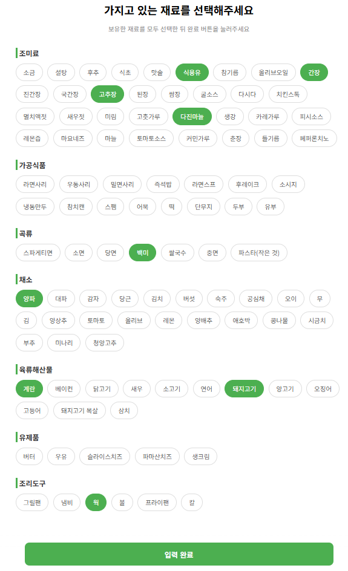
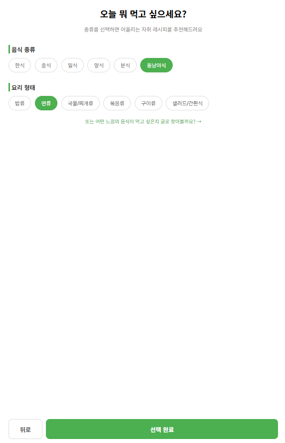
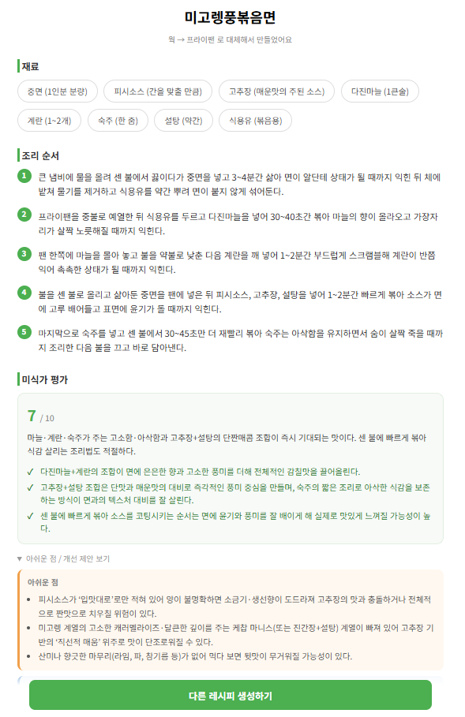

# 자취생 요리 추천 (LLM + Multi-Agent 개인 프로젝트)


집에 있는 재료·조리도구와 원하는 요리 종류만 고르면, AI가 만들 수 있는 메뉴를 골라 레시피를 생성하고 스스로 평가까지 해주는 요리 추천 서비스.

## 데모

| 재료·조리도구 선택 | 카테고리 선택 | 레시피 결과 |
|---|---|---|
|  |  |  |

## 프로젝트 목적

- LLM에게 맡길 판단(재료 대체, 레시피 생성, 맛 평가)과 코드로 처리할 로직(재고·도구 대조, 조건 분기, 재시도 여부)을 명확히 분리하는 구조 연습
- 생성 에이전트와 평가 에이전트를 분리한 Multi-Agent 구조로 self-consistency 문제 회피
- LangGraph 기반 State 관리 및 조건부 분기(재생성 사이클) 연습

## 전체 흐름

```
[재료 / 조리도구 입력 - 토글] (DB 저장)
        ↓
[카테고리 선택] (한식/중식/양식 등, 면류/밥류 등)
   또는
[자연어 검색] "얼큰한 국물 요리 먹고싶어" 같은 문장 입력
        ↓
[레시피 후보 확정] POST /recipe/candidate 또는 POST /recipe/search
   카테고리 선택 경로: 카테고리와 일치하는 레시피 문서 중 순서대로 확인
   자연어 검색 경로: 벡터·키워드 후보 풀 → LLM 재랭킹으로 정렬된 순서대로 확인
     - main_tool을 보유하지 않음 → 후보 제외
     - base_ingredients가 부족해도 substitution_table의 대체품을 보유 → 대체재로 인정
     - 그래도 부족 → 후보 제외
   위 조건을 만족하는 첫 번째 메뉴를 후보로 확정 (없으면 "no_candidate")
        ↓
[맵기 / 굽기 선택] (필요한 단계가 있고, 그 단계에 필요한 재료를 보유한 경우만 옵션으로 노출)
        ↓
[레시피 생성] POST /recipe/generate (LangGraph)
   요리사 에이전트 → 레시피 생성
        ↓
   코드 검증: 맵기 재료 언급 여부 / 굽기 시간·온도 반영 여부 / 대체재 반영 여부
        ↓
   미식가 에이전트 → 점수 + comment + issues/suggestions
        ↓
   (검증 실패 또는 점수 < 임계값) && 재시도 안 했음?
     ├─ Yes → 1회 재생성 (이전 결과는 보여주지 않고, 어떤 실수를 피해야 하는지만 알려주고 처음부터 재작성) → 결과 그대로 표시
     └─ No  → 바로 표시
        ↓
[결과 화면] 메뉴 / 재료 / 조리순서 / 대체 재료 안내 / 미식가 평가(점수·코멘트·이슈) 표시
```

## 기술 스택

- **Backend**: FastAPI, SQLAlchemy, MySQL
- **Frontend**: React (Vite), Axios, React Router
- **LLM**: OpenAI gpt-5-mini
- **Embedding / Vector DB**: OpenAI text-embedding-3-large, ChromaDB
- **Agent Orchestration**: LangGraph

## 자연어 검색 (RAG)

카테고리를 직접 고르지 않고 "얼큰한 국물 요리 먹고싶어"처럼 자연어로 입력해도 레시피를 찾을 수 있습니다.

```
사용자 자연어 쿼리
        ↓
[1차 검색] 두 갈래로 후보를 모읍니다
   - 벡터 검색: ChromaDB 유사도 top-10. 쿼리에 카테고리를 암시하는 단어(국물/면/밥/볶음/구이/샐러드 등)가
     있으면 dish_type 메타데이터로 먼저 필터링한 뒤 검색
   - 키워드 검색: 레시피 설명(embedding_text)에 대한 BM25 top-10 (한글은 2글자 조각 기준)
   두 후보를 번갈아 담아 중복을 없앤 하나의 후보 풀(최대 20개)로 합칩니다
        ↓
[2차 재랭킹] LLM이 후보 풀의 실제 설명(embedding_text)을 읽고 쿼리 의도에 맞게 재정렬
   실패 시 후보 풀의 원래 순서를 그대로 사용 (검색 자체는 항상 동작)
        ↓
[레시피 후보 확정] 재랭킹된 순서대로 보유 재료·도구로 만들 수 있는 첫 번째 레시피 선택
```

**왜 후보 풀 + 재랭킹인가**: 110개 레시피 규모에서도 벡터 유사도만으로는 "얼큰한 국물"처럼 카테고리를 직접 언급한 쿼리에 국물류가 아닌 반찬이 끼어들었습니다. 그래서 쿼리가 카테고리를 언급하면 메타데이터 필터로 먼저 좁히고, 후보들의 미묘한 의도(맛·식감·상황)는 LLM이 설명 텍스트를 읽고 재정렬하게 했습니다. 처음에는 BM25 같은 키워드 검색은 레시피 수가 적어 필요 없다고 판단했는데, 12개 쿼리로만 본 판단이었습니다. 쿼리를 217개로 늘려 다시 보니 한계는 재랭킹이 아니라 후보였습니다. 벡터 top-10 후보 안에 정답이 47%(최종용 기준)만 있어서 재랭킹이 고를 수 있는 범위가 좁았고, 키워드 후보를 함께 모으자 후보 안의 정답이 78%로 올라 같은 재랭킹으로 Hit@1이 36%에서 49%가 됐습니다.

**검색 품질 평가**: 평가는 두 종류입니다.

- `backend/evaluation/eval_cases.py` (쿼리 12개, 정답 여러 개 인정): 개발하면서 직접 본 쿼리를 회귀 테스트용으로 고정한 것입니다. 이전 구성(카테고리 필터 + 재랭킹)은 이 쿼리에서 Hit@1 83% / MRR 0.86대였습니다 (재랭킹 적용 전 Hit@1 58% / MRR 0.68대). 재랭킹 호출이 `temperature`를 고정하지 않아 같은 데이터로 다시 돌려도 점수가 소폭(±0.01~0.02) 흔들릴 수 있어 범위로 표기합니다. 다만 12개 쿼리는 개발하면서 직접 본 쿼리이고 카테고리 필터 규칙도 이 쿼리에 맞춰 만들었기 때문에 개발용 점수입니다. Hit@1 7/12 → 10/12는 쿼리 3개 차이라서 일반화된 성능으로 읽으면 안 됩니다. 현재 구성에서는 이 12개 쿼리가 12/12로 만점이라 구성을 구분하지 못해 회귀 테스트로만 씁니다.
- `backend/evaluation/bench/` (쿼리 217개, 정답 레시피 1개): 레시피마다 LLM이 만든 문장 2개로 구성했고, 정답 이름·주재료가 들어간 문장은 코드로 걸러 다시 만들었습니다. 개발용 97개로 구성을 비교하고, 최종용 120개는 구성을 정한 뒤 한 번만 돌렸습니다(레시피 단위로 분할). 최종용 결과:

| 구성 | Hit@1 (95% 신뢰구간) | Hit@3 | Hit@10 | MRR | 후보 안에 정답 |
|---|---|---|---|---|---|
| 벡터만 | 12% (8~20%) | 28% | 45% | 0.22 | 45% |
| 키워드(BM25)만 | 28% (20~36%) | 45% | 71% | 0.40 | 71% |
| 하이브리드(순위 합산, LLM 없음) | 23% (17~32%) | 41% | 63% | 0.35 | 63% |
| 이전 구성(카테고리 필터 + LLM 재랭킹) | 36% (28~45%) | 43% | 47% | 0.40 | 47% |
| **현재 구성(후보 풀 + LLM 재랭킹)** | **49% (40~58%)** | **67%** | **78%** | **0.60** | **78%** |

이전 구성보다 1위 적중이 나아진 쿼리가 22개, 나빠진 쿼리가 6개입니다 (부호검정 p=0.004). 무작위로 뽑으면 Hit@1은 0.9%입니다.

읽을 때 주의할 점:
- 정답을 1개로 정한 엄격한 기준이라 정답을 여러 개 인정하는 12개 쿼리 점수와 직접 비교하면 안 됩니다. 12개 쿼리에서는 키워드 검색만으로도 Hit@1 11/12가 나왔는데, 12개 쿼리가 키워드로 맞히기 쉬운 쿼리였다는 뜻으로 읽습니다.
- 쿼리를 LLM이 만들어 정답이 하나로 정해지지 않는 쿼리가 섞여 있습니다. 217개 중 40개를 직접 확인했을 때 적절한 쿼리는 25개(62%)였고 나머지는 모호하거나 부적절했습니다. 그래서 절대 점수는 낮게 나오는 쪽입니다.
- 각 구성은 한 번씩만 돌렸고 LLM 호출의 재실행 변동은 측정하지 않았습니다.
- 평가 실험의 LLM 호출은 `reasoning_effort="minimal"`로 돌렸습니다. 12개 쿼리 파일럿에서 기본 설정과 점수가 같았고(Hit@1 11/12) 출력 토큰이 약 1/25, 호출 시간이 약 1/7이었습니다. 서비스의 재랭커도 gpt-5 계열일 때 같은 옵션을 씁니다.

```bash
cd backend
python evaluation/run_eval.py
```

## 실행 방법

### Backend

```bash
cd backend
venv\Scripts\activate
uvicorn main:app --reload
```

`backend/.env.example`을 복사해 `backend/.env`를 만들고 `OPENAI_API_KEY`, `OPENAI_MODEL`(기본 gpt-5-mini), `DATABASE_URL`(MySQL 접속 정보)을 설정해야 합니다.

### Frontend

```bash
cd frontend
npm install
npm run dev
```

### 재료 시드 데이터

```bash
cd backend
python table.py
```

`ingredients_seed.csv`를 읽어 DB에 없는 재료만 추가합니다 (재실행해도 중복 삽입되지 않음).

## API 명세

| Method | Endpoint | 설명 |
|---|---|---|
| GET | `/ingredient/` | 전체 재료·조리도구 목록 조회 |
| POST | `/ingredient/{id}` | 특정 재료의 `owned` 토글 |
| POST | `/category/` | 카테고리(cuisine, dish_type) 선택값 저장 |
| GET | `/category/{id}` | 저장된 카테고리 조회 |
| POST | `/recipe/candidate` | 카테고리 + 보유 재료·도구로 레시피 후보 확정 |
| POST | `/recipe/search` | 자연어 쿼리(벡터·키워드 후보 풀 + LLM 재랭킹) + 보유 재료·도구로 레시피 후보 확정 |
| POST | `/recipe/generate` | 확정된 후보 + 맵기/굽기/대체재로 최종 레시피 생성 |

**`POST /recipe/search` 요청/응답 예시** (응답 형태는 `/recipe/candidate`와 동일)
```json
// 요청
{ "query": "얼큰한 국물 요리가 땡기네" }
```

**`POST /recipe/candidate` 응답 예시**
```json
{
  "status": "ready",
  "recipe_ref": "동남아식_면류_팟타이",
  "menu": "팟타이",
  "needs_spice": true,
  "needs_doneness": false,
  "spice_options": ["순한맛", "매운맛"],
  "doneness_options": [],
  "substitutions": { "새우": "돼지고기", "피시소스": "멸치액젓" }
}
```

**`POST /recipe/generate` 응답 예시**
```json
{
  "status": "done",
  "menu": "팟타이",
  "ingredients": ["쌀국수", "돼지고기", "계란", "숙주", "다진마늘", "멸치액젓", "설탕", "식용유", "고춧가루", "청양고추"],
  "steps": "...",
  "score": 7,
  "feedback": {
    "score": 7,
    "comment": "조리 순서가 구체적이고 따라하기 쉬움",
    "issues": [],
    "suggestions": ["양념의 양과 맛의 조절법에 대해 더 자세히 설명하는 것이 도움이 될 것"]
  }
}
```

## 데이터 설계

### 재료 / 조리도구 (MySQL, `ingredients` 테이블)

```python
class Ingredients(Base):
    __tablename__ = "ingredients"

    id = Column(Integer, primary_key=True, autoincrement=True)
    name = Column(String(255))
    category = Column(String(100))
    type = Column(String(100))       # 토글 UI 그룹핑 기준 (조미료/채소/조리도구 등)
    owned = Column(Boolean, default=False, nullable=False)
```

조리도구도 같은 테이블에 `category="조리도구"`로 저장해서, 재료와 동일한 토글 UI/보유 여부 로직을 그대로 재사용합니다.

### 레시피 문서 (`backend/recipes/<cuisine>/<dish_type>/<menu>.md`)

MySQL이 아니라 마크다운 파일로 관리 (YAML frontmatter + 자유 텍스트 조리방법). `crud/recipe.py`가 전체 파일을 읽어 `cuisine`/`dish_type` 필드 기준으로 필터링합니다. 자연어 검색 1회당 재랭킹된 후보(최대 10개) 각각을 `get_by_ref`로 조회하면서 매번 전체 파일을 다시 읽고 파싱하는 게 병목이어서(로컬 측정 약 1.7초), `lru_cache`로 최초 1회만 읽고 `recipe_ref → 레시피` 딕셔너리를 캐싱하도록 바꿨습니다. 레시피 md를 수정하면 서버를 재시작해야 반영됩니다.

| 필드 | 내용 |
|---|---|
| `base_ingredients` | 기본 재료 목록 |
| `substitution_table` | 재료별 대체 가능 품목 |
| `spice_level_table` | 맵기 단계별 재료/양 |
| `doneness_table` | 굽기 단계별 시간/온도 (nullable) |
| `main_tool` | 필수 조리도구 |
| `embedding_text` | 자연어 검색용 임베딩 대상 텍스트 (메뉴명/카테고리/맛 설명) |

### 벡터 인덱스 (ChromaDB, `backend/chroma_db/`)

레시피의 `embedding_text`를 OpenAI 임베딩(`text-embedding-3-large`)으로 변환해 `cuisine`/`dish_type`/`menu` 메타데이터와 함께 저장합니다. 임베딩 모델을 바꾸면 벡터 차원이 달라질 수 있어, 색인 시점에 컬렉션을 삭제 후 재생성합니다(`vectorstore/chroma_store.py`의 `rebuild_index`).

## 역할 분리

| 코드(결정론적)가 처리 | LLM이 처리 |
|---|---|
| 재고·조리도구 보유 대조 | 레시피 생성 (요리사 에이전트) |
| 대체 재료 후보 조회 (substitution_table) | 레시피 전반적인 완성도 평가 (미식가 에이전트) |
| 맵기 재료 언급 여부 / 굽기 시간·온도 반영 여부 / 대체재 반영 여부 검증 | — |
| 임계값·검증 결과 기반 재시도 여부 판단 | — |

레시피 생성 결과가 지시(필수 재료 언급, 대체재 반영 등)를 지켰는지는 LLM 자체 판단에 맡기지 않고 문자열 검증으로 코드가 직접 확인합니다 — 미식가 에이전트가 이 판단을 종종 틀리게 내리는 걸 확인했기 때문입니다.
