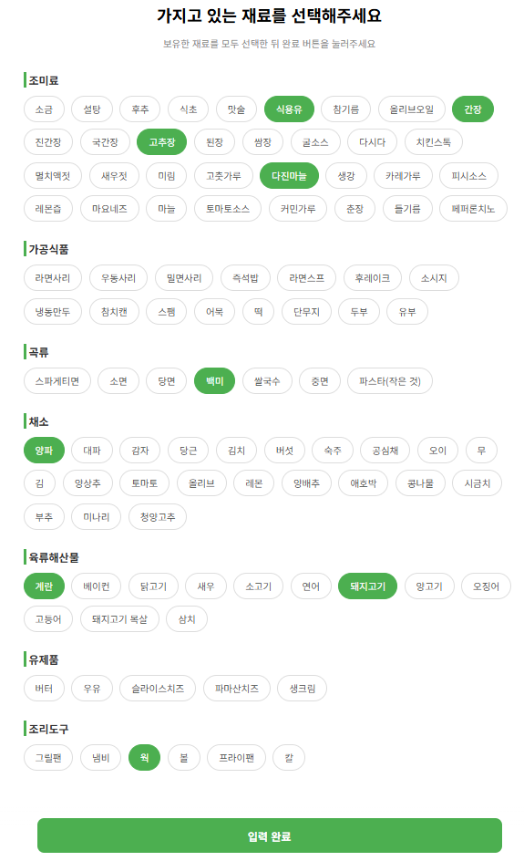
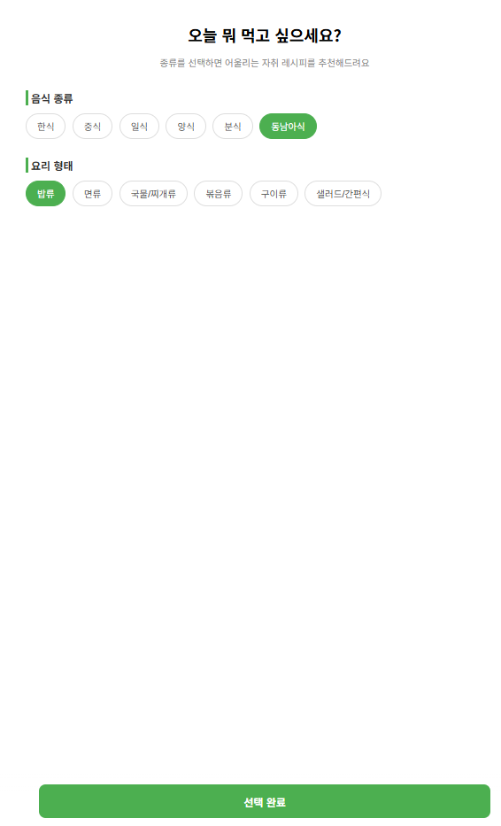
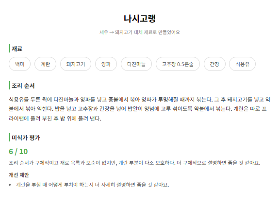

# 자취생 요리 추천 (LLM + Multi-Agent 개인 프로젝트)


집에 있는 재료·조리도구와 원하는 요리 종류만 고르면, AI가 만들 수 있는 메뉴를 골라 레시피를 생성하고 스스로 평가까지 해주는 요리 추천 서비스.

## 데모

| 재료·조리도구 선택 | 카테고리 선택 | 레시피 결과 |
|---|---|---|
|  |  |  |

## 프로젝트 목적

- LLM에게 맡길 판단(재료 대체, 레시피 생성, 맛 평가)과 코드로 처리할 로직(재고·도구 대조, 조건 분기, 재시도 여부)을 명확히 분리하는 구조 연습
- 생성 에이전트와 평가 에이전트를 분리한 Multi-Agent 구조로 self-consistency 문제 회피
- LangGraph 기반 State 관리 및 조건부 분기(재생성 사이클) 연습

## 전체 흐름

```
[재료 / 조리도구 입력 - 토글] (DB 저장)
        ↓
[카테고리 선택] (한식/중식/양식 등, 면류/밥류 등)
   또는
[자연어 검색] "얼큰한 국물 요리 먹고싶어" 같은 문장 입력
        ↓
[레시피 후보 확정] POST /recipe/candidate 또는 POST /recipe/search
   카테고리 선택 경로: 카테고리와 일치하는 레시피 문서 중 순서대로 확인
   자연어 검색 경로: ChromaDB 벡터 검색 → LLM 재랭킹으로 정렬된 순서대로 확인
     - main_tool을 보유하지 않음 → 후보 제외
     - base_ingredients가 부족해도 substitution_table의 대체품을 보유 → 대체재로 인정
     - 그래도 부족 → 후보 제외
   위 조건을 만족하는 첫 번째 메뉴를 후보로 확정 (없으면 "no_candidate")
        ↓
[맵기 / 굽기 선택] (필요한 단계가 있고, 그 단계에 필요한 재료를 보유한 경우만 옵션으로 노출)
        ↓
[레시피 생성] POST /recipe/generate (LangGraph)
   요리사 에이전트 → 레시피 생성
        ↓
   코드 검증: 맵기 재료 언급 여부 / 굽기 시간·온도 반영 여부 / 대체재 반영 여부
        ↓
   미식가 에이전트 → 점수 + comment + issues/suggestions
        ↓
   (검증 실패 또는 점수 < 임계값) && 재시도 안 했음?
     ├─ Yes → 1회 재생성 (이전 결과는 보여주지 않고, 어떤 실수를 피해야 하는지만 알려주고 처음부터 재작성) → 결과 그대로 표시
     └─ No  → 바로 표시
        ↓
[결과 화면] 메뉴 / 재료 / 조리순서 / 대체 재료 안내 / 미식가 평가(점수·코멘트·이슈) 표시
```

## 기술 스택

- **Backend**: FastAPI, SQLAlchemy, MySQL
- **Frontend**: React (Vite), Axios, React Router
- **LLM**: OpenAI gpt-5-mini
- **Embedding / Vector DB**: OpenAI text-embedding-3-large, ChromaDB
- **Agent Orchestration**: LangGraph

## 자연어 검색 (RAG)

카테고리를 직접 고르지 않고 "얼큰한 국물 요리 먹고싶어"처럼 자연어로 입력해도 레시피를 찾을 수 있습니다.

```
사용자 자연어 쿼리
        ↓
[1차 검색] ChromaDB 벡터 유사도 검색 (n_results=10)
   쿼리에 카테고리를 암시하는 단어(국물/면/밥/볶음/구이/샐러드 등)가 있으면
   dish_type 메타데이터로 먼저 필터링한 뒤 벡터 검색 (하이브리드: 메타데이터 필터 + 벡터 검색)
        ↓
[2차 재랭킹] LLM이 후보 10개의 실제 설명(embedding_text)을 읽고 쿼리 의도에 맞게 재정렬
   실패 시 원래 벡터 검색 순서를 그대로 사용 (검색 자체는 항상 동작)
        ↓
[레시피 후보 확정] 재랭킹된 순서대로 보유 재료·도구로 만들 수 있는 첫 번째 레시피 선택
```

**왜 메타데이터 필터 + 재랭킹인가**: 110개 레시피 규모에서는 벡터 유사도만으로는 "얼큰한 국물"처럼 카테고리를 직접 언급한 쿼리에도 국물류가 아닌 반찬이 끼어드는 문제가 있었습니다. 쿼리가 카테고리를 언급하면 메타데이터 필터로 먼저 좁히고, 그렇게 좁힌 후보들 안에서는 벡터 유사도가 놓치는 미묘한 의도(맛·식감·상황)를 LLM이 설명 텍스트를 직접 읽고 재정렬합니다. BM25 같은 키워드 기반 점수는 레시피 수가 적어 별도 가중합 없이도 LLM 재랭킹 한 번으로 충분하다고 판단해 넣지 않았습니다.

**검색 품질 평가**: `backend/evaluation/`에 고정 평가셋(`eval_cases.py`, 자연어 쿼리 12개 + 정답 레시피)과 평가 스크립트(`run_eval.py`)가 있습니다. 실제 검색 파이프라인(`chroma_store.search` → `reranker.rerank`)을 그대로 돌려 Hit@1/3/5/10, MRR을 계산하고 `eval_history.jsonl`에 기록을 쌓습니다 (재랭킹 적용 전 Hit@1 58% / MRR 0.683 → 적용 후 Hit@1 83% / MRR 0.875).

```bash
cd backend
python evaluation/run_eval.py
```

## 실행 방법

### Backend

```bash
cd backend
venv\Scripts\activate
uvicorn main:app --reload
```

`backend/.env`에 `OPENAI_API_KEY`, `OPENAI_MODEL`(기본 gpt-5-mini)을 설정해야 합니다. MySQL 접속 정보는 `backend/database.py`에 있습니다.

### Frontend

```bash
cd frontend
npm install
npm run dev
```

### 재료 시드 데이터

```bash
cd backend
python table.py
```

`ingredients_seed.csv`를 읽어 DB에 없는 재료만 추가합니다 (재실행해도 중복 삽입되지 않음).

## API 명세

| Method | Endpoint | 설명 |
|---|---|---|
| GET | `/ingredient/` | 전체 재료·조리도구 목록 조회 |
| POST | `/ingredient/{id}` | 특정 재료의 `owned` 토글 |
| POST | `/category/` | 카테고리(cuisine, dish_type) 선택값 저장 |
| GET | `/category/{id}` | 저장된 카테고리 조회 |
| POST | `/recipe/candidate` | 카테고리 + 보유 재료·도구로 레시피 후보 확정 |
| POST | `/recipe/search` | 자연어 쿼리(벡터 검색 + LLM 재랭킹) + 보유 재료·도구로 레시피 후보 확정 |
| POST | `/recipe/generate` | 확정된 후보 + 맵기/굽기/대체재로 최종 레시피 생성 |

**`POST /recipe/search` 요청/응답 예시** (응답 형태는 `/recipe/candidate`와 동일)
```json
// 요청
{ "query": "얼큰한 국물 요리가 땡기네" }
```

**`POST /recipe/candidate` 응답 예시**
```json
{
  "status": "ready",
  "recipe_ref": "동남아식_면류_팟타이",
  "menu": "팟타이",
  "needs_spice": true,
  "needs_doneness": false,
  "spice_options": ["순한맛", "매운맛"],
  "doneness_options": [],
  "substitutions": { "새우": "돼지고기", "피시소스": "멸치액젓" }
}
```

**`POST /recipe/generate` 응답 예시**
```json
{
  "status": "done",
  "menu": "팟타이",
  "ingredients": ["쌀국수", "돼지고기", "계란", "숙주", "다진마늘", "멸치액젓", "설탕", "식용유", "고춧가루", "청양고추"],
  "steps": "...",
  "score": 7,
  "feedback": {
    "score": 7,
    "comment": "조리 순서가 구체적이고 따라하기 쉬움",
    "issues": [],
    "suggestions": ["양념의 양과 맛의 조절법에 대해 더 자세히 설명하는 것이 도움이 될 것"]
  }
}
```

## 데이터 설계

### 재료 / 조리도구 (MySQL, `ingredients` 테이블)

```python
class Ingredients(Base):
    __tablename__ = "ingredients"

    id = Column(Integer, primary_key=True, autoincrement=True)
    name = Column(String(255))
    category = Column(String(100))
    type = Column(String(100))       # 토글 UI 그룹핑 기준 (조미료/채소/조리도구 등)
    owned = Column(Boolean, default=False, nullable=False)
```

조리도구도 같은 테이블에 `category="조리도구"`로 저장해서, 재료와 동일한 토글 UI/보유 여부 로직을 그대로 재사용합니다.

### 레시피 문서 (`backend/recipes/<cuisine>/<dish_type>/<menu>.md`)

MySQL이 아니라 마크다운 파일로 관리 (YAML frontmatter + 자유 텍스트 조리방법). `crud/recipe.py`가 실행 시점에 전체 파일을 읽어 `cuisine`/`dish_type` 필드 기준으로 필터링합니다.

| 필드 | 내용 |
|---|---|
| `base_ingredients` | 기본 재료 목록 |
| `substitution_table` | 재료별 대체 가능 품목 |
| `spice_level_table` | 맵기 단계별 재료/양 |
| `doneness_table` | 굽기 단계별 시간/온도 (nullable) |
| `main_tool` | 필수 조리도구 |
| `embedding_text` | 자연어 검색용 임베딩 대상 텍스트 (메뉴명/카테고리/맛 설명) |

### 벡터 인덱스 (ChromaDB, `backend/chroma_db/`)

레시피의 `embedding_text`를 OpenAI 임베딩(`text-embedding-3-large`)으로 변환해 `cuisine`/`dish_type`/`menu` 메타데이터와 함께 저장합니다. 임베딩 모델을 바꾸면 벡터 차원이 달라질 수 있어, 색인 시점에 컬렉션을 삭제 후 재생성합니다(`vectorstore/chroma_store.py`의 `rebuild_index`).

## 역할 분리

| 코드(결정론적)가 처리 | LLM이 처리 |
|---|---|
| 재고·조리도구 보유 대조 | 레시피 생성 (요리사 에이전트) |
| 대체 재료 후보 조회 (substitution_table) | 레시피 전반적인 완성도 평가 (미식가 에이전트) |
| 맵기 재료 언급 여부 / 굽기 시간·온도 반영 여부 / 대체재 반영 여부 검증 | — |
| 임계값·검증 결과 기반 재시도 여부 판단 | — |

레시피 생성 결과가 지시(필수 재료 언급, 대체재 반영 등)를 지켰는지는 LLM 자체 판단에 맡기지 않고 문자열 검증으로 코드가 직접 확인합니다 — 미식가 에이전트가 이 판단을 종종 틀리게 내리는 걸 확인했기 때문입니다.
